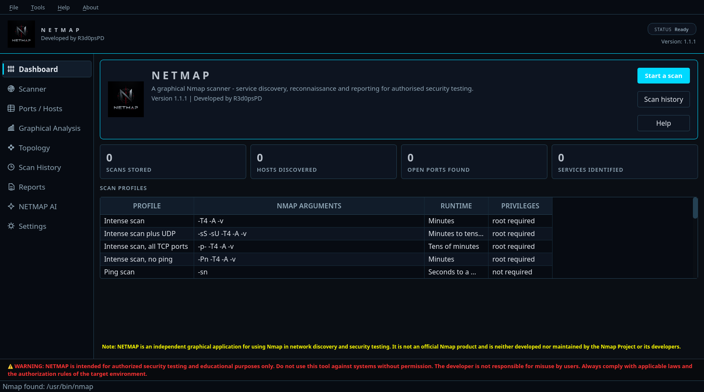
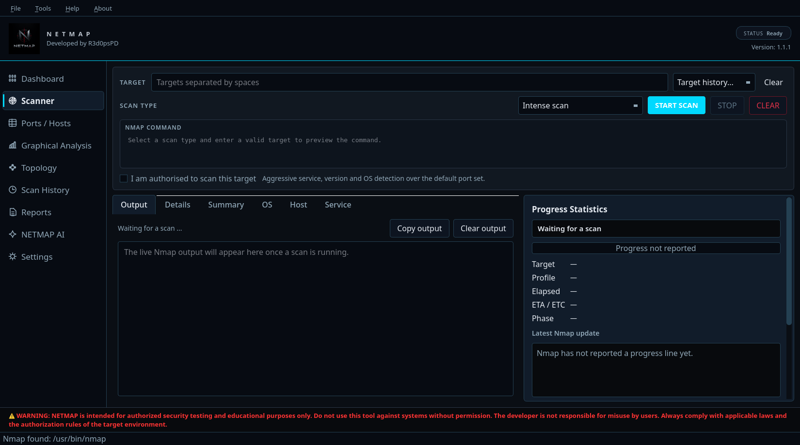
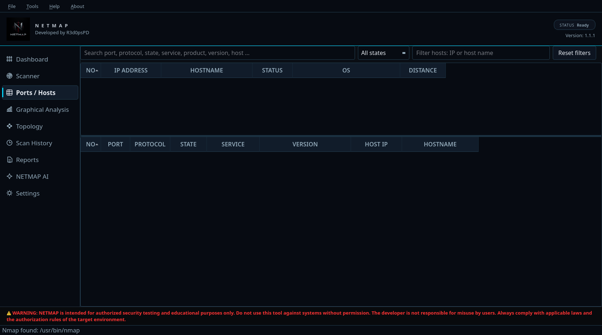
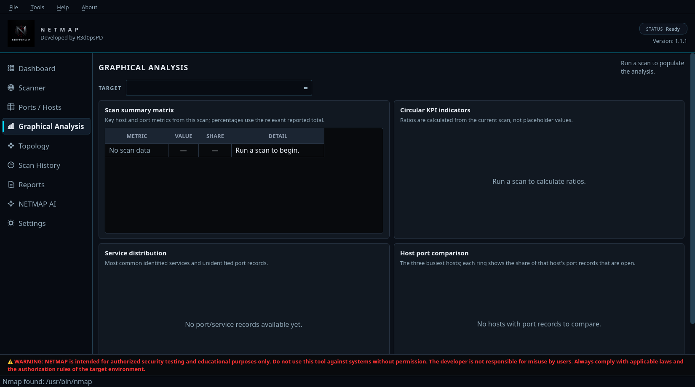
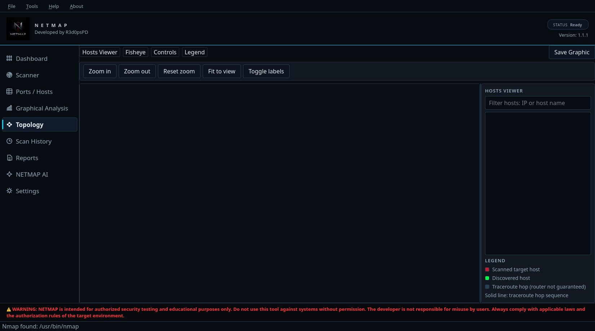
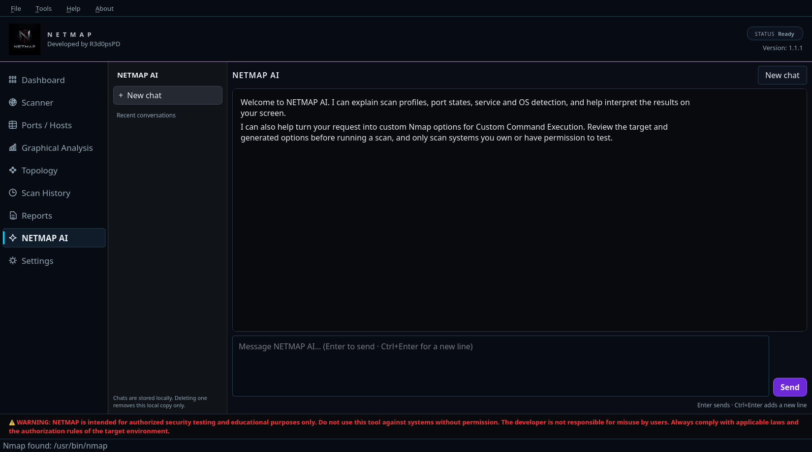
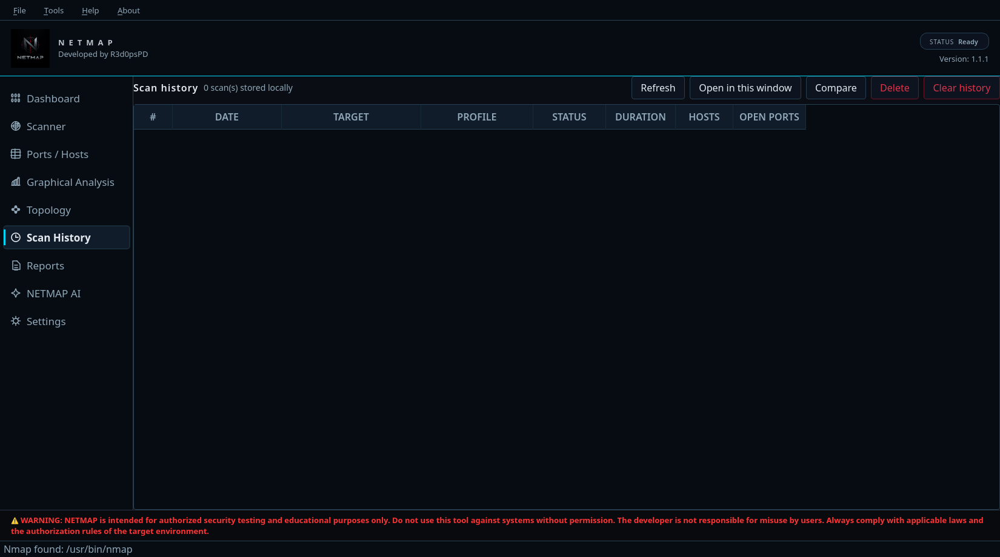
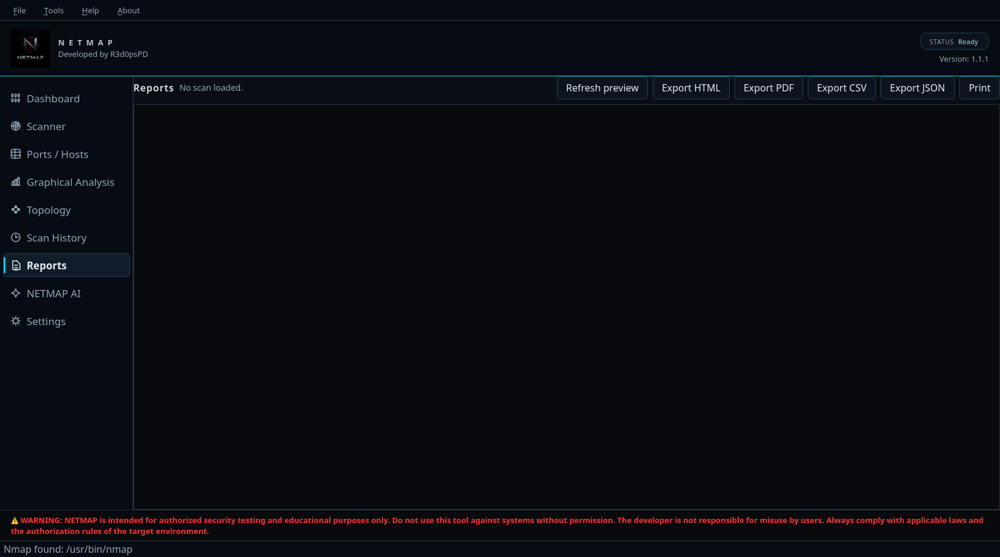
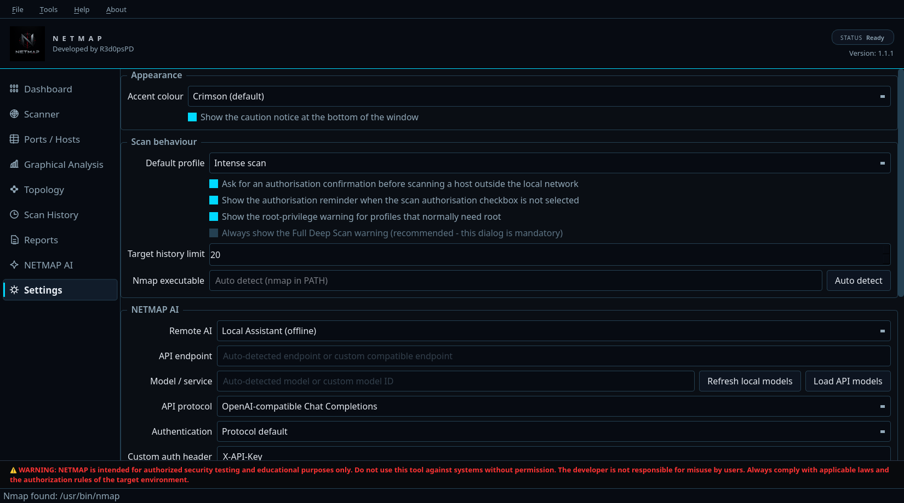
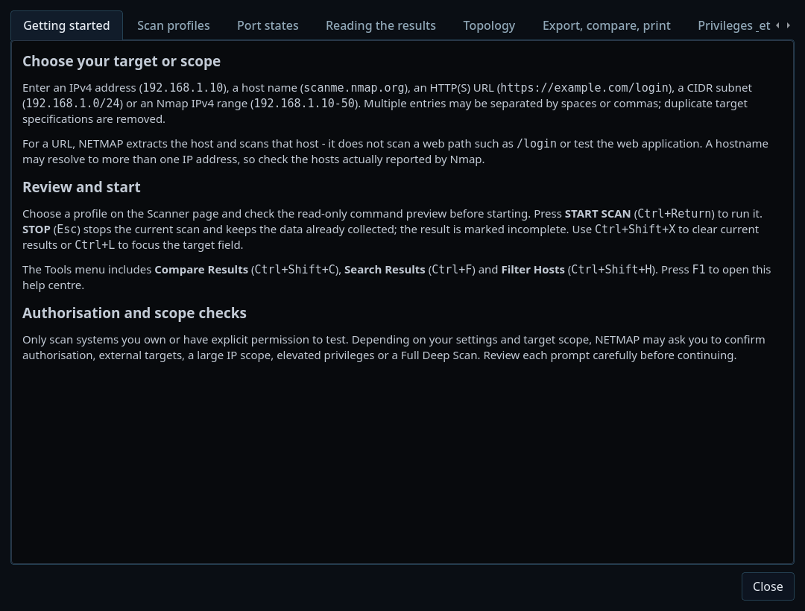

# NETMAP Linux Release

NETMAP is an independent desktop application for using Nmap for authorized network discovery, service analysis, topology visualization, and reporting. It is not an official Nmap product.

## Download and install

Download the compiled application ZIP and the checksum file from the **Assets** section of the NETMAP GitHub release. Do not use `git clone` to install NETMAP: the distribution repository is not the application source repository.

### Option A — Download from a terminal with curl

The commands below download the release directly from GitHub. They will work when the distribution repository is accessible to your GitHub account.

```bash
mkdir -p ~/Downloads/netmap-1.1.1
cd ~/Downloads/netmap-1.1.1

curl --fail --location --show-error \
  --output NETMAP-1.1.1-linux-x86_64.zip \
  https://github.com/R3d0psPD/Netmap/releases/download/v1.1.1/NETMAP-1.1.1-linux-x86_64.zip

curl --fail --location --show-error \
  --output SHA256SUMS \
  https://github.com/R3d0psPD/Netmap/releases/download/v1.1.1/SHA256SUMS

sha256sum -c SHA256SUMS
unzip NETMAP-1.1.1-linux-x86_64.zip
cd NETMAP-Linux-x86_64
./NETMAP
```

The checksum command must report `NETMAP-1.1.1-linux-x86_64.zip: OK` before you run the package.

### Option B — Download with wget

```bash
mkdir -p ~/Downloads/netmap-1.1.1
cd ~/Downloads/netmap-1.1.1

wget -O NETMAP-1.1.1-linux-x86_64.zip \
  https://github.com/R3d0psPD/Netmap/releases/download/v1.1.1/NETMAP-1.1.1-linux-x86_64.zip
wget -O SHA256SUMS \
  https://github.com/R3d0psPD/Netmap/releases/download/v1.1.1/SHA256SUMS

sha256sum -c SHA256SUMS
unzip NETMAP-1.1.1-linux-x86_64.zip
cd NETMAP-Linux-x86_64
./NETMAP
```

## Requirements

- 64-bit Linux on x86_64 with a supported glibc environment.
- Nmap installed and available as `nmap` in `PATH`. Nmap is not bundled.
- An operating-system credential manager, such as KWallet or Secret Service, if you want NETMAP to save provider API keys.
- Internet access for remote AI services.

On Kali Linux or Debian-based systems, install Nmap with:

```bash
sudo apt update
sudo apt install nmap
```

This release does not include a native Windows package.

## NETMAP AI

Each user supplies their own provider API key in **Settings > NETMAP AI**. NETMAP does not include a shared developer API key. Supported protocols and authentication options depend on the selected provider or custom endpoint. Use **Load API models** to query the selected endpoint, then use **Test connection** before sending a request.

Saved API credentials use the operating system's credential manager when available. NETMAP does not promise that every provider or model is compatible. Provider availability, rate limits, and charges are controlled by the provider.

Review scan-context and privacy options before sending prompts or scan details to a remote AI service. Local knowledge features may still be available without a cloud request.

## Local data and privacy

NETMAP scan history, target history, settings, and AI conversation history are stored locally for the current operating-system user. They are not included in this download and are not automatically sent to other NETMAP users.

The compiled release stores its local database under `$XDG_DATA_HOME/netmap`, or `~/.local/share/netmap` when `XDG_DATA_HOME` is not set. A source-development checkout uses the separate legacy `~/.netmap` directory. This separation prevents the downloaded release from reusing scan history created by the source-development copy on the same computer.

Each operating-system account has its own home/data directory. Do not share your local database or screenshots containing scan details with others unless you have reviewed and sanitized them.

## Usage and authorization

Use NETMAP only against systems you own or have explicit permission to test. Scanning behaviour depends on Nmap, target responses, network conditions, and available privileges. NETMAP does not guarantee that every host or service will be discovered.

## Screenshots

These screenshots were captured from a clean, isolated NETMAP profile with no saved scans, targets, conversations, or API keys. They are not screenshots of a developer's personal history or configuration.

| | |
| --- | --- |
|  |  |
| **Dashboard** | **Scanner** |
|  |  |
| **Ports / Hosts** | **Graphical Analysis** |
|  |  |
| **Topology** | **NETMAP AI** |
|  |  |
| **Scan History** | **Reports** |
|  |  |
| **AI Settings** | **Help** |

## License and source availability

NETMAP is distributed as a compiled application under the proprietary terms in EULA.md. The NETMAP application source code is not included in this repository or the release package. Unauthorized redistribution of NETMAP is prohibited, subject to rights that cannot be restricted under applicable law or the licenses of third-party components.

GitHub automatically displays `Source code (zip)` and `Source code (tar.gz)` for release tags. Those links snapshot this distribution repository, which contains only documentation, screenshots, branding, and third-party license materials—not the NETMAP application Python source code. End users should download the compiled ZIP listed in the release assets.

Qt/PySide and other third-party components retain their respective licenses. Read THIRD_PARTY_NOTICES.md, LICENSES/, and THIRD_PARTY_SOURCES.md. Third-party source archives are provided for their license requirements; they are not NETMAP application source code.
